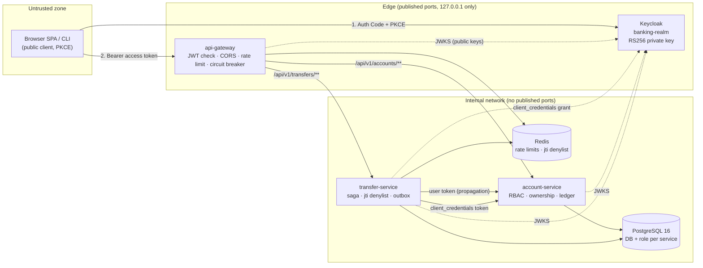
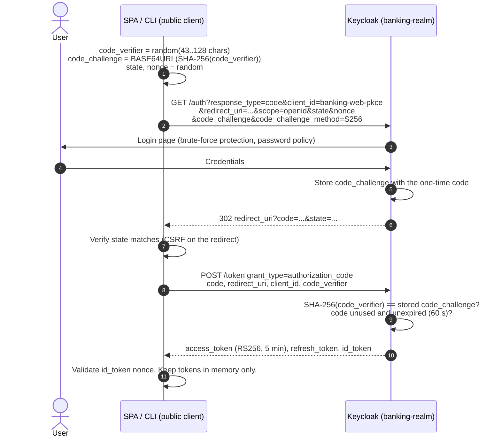
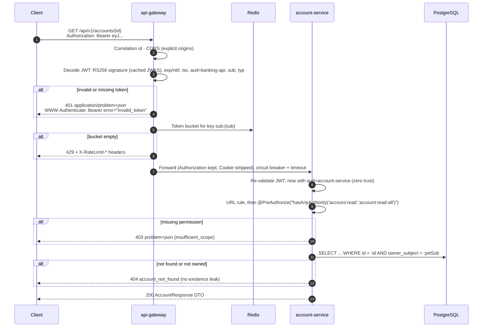
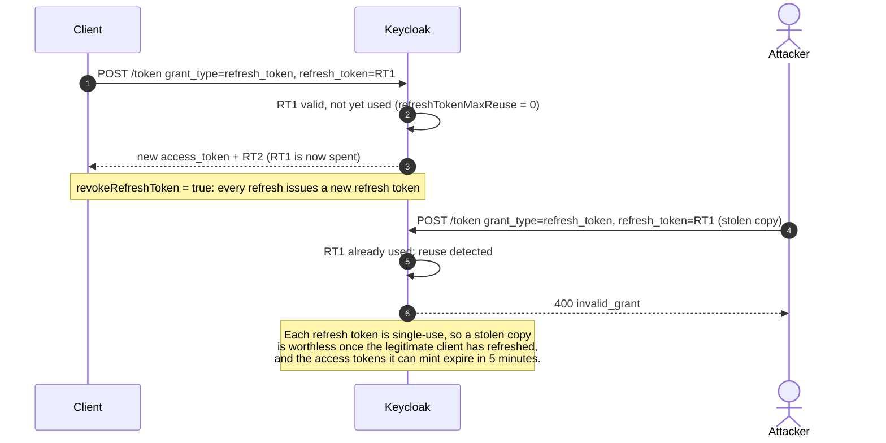
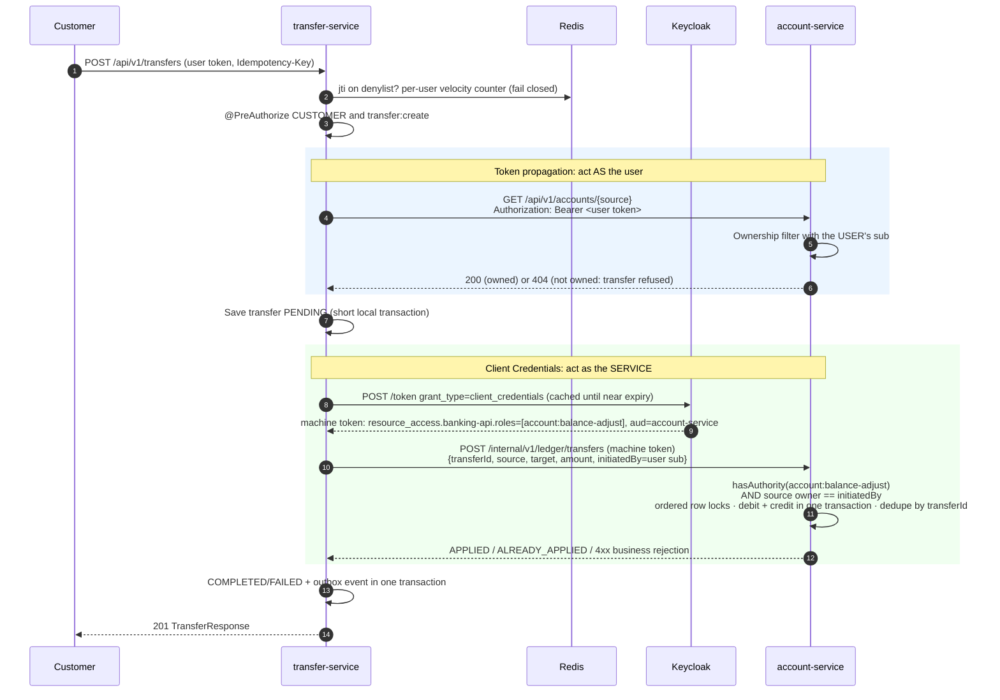

# Security Architecture

**Fintech OAuth 2.0 / OIDC Microservices Platform** · Author: Jyotiprakash Parida

This document explains how identity, tokens and authorization work across the platform, and the
system-design patterns used to keep it secure and resilient. Every claim here maps to code or configuration
in this repository.

---

## 1. Components and trust boundaries



- Only **Keycloak** and the **gateway** publish ports, and both bind to `127.0.0.1`. Services, databases and Redis are reachable only on the internal Docker network.
- **No service trusts the network.** Every service validates the JWT itself (zero trust / defense in depth), so a request that bypasses the gateway still needs a valid token.
- `/internal/**` endpoints are never routed by the gateway, and they also require a machine-only permission.

---

## 2. Tokens: asymmetric RS256 and JWKS

### 2.1 Signing and verification

| Step | Where | What happens |
|---|---|---|
| Sign | Keycloak | The `rsa-generated` key provider (`rsa-rs256-signing`, priority 200) holds a 2048-bit RSA **private** key. It never leaves Keycloak. Each access token's JOSE header carries `alg=RS256` and a `kid`. |
| Publish | Keycloak | The **public** keys are served as a JWK Set at `/realms/banking-realm/protocol/openid-connect/certs`. |
| Discover | Services | `NimbusJwtDecoder.withIssuerLocation(issuer)` reads `/.well-known/openid-configuration`. It checks that the advertised `issuer` matches and follows `jwks_uri`. This happens lazily, so services start even when Keycloak is still booting. |
| Cache | Services | The JWK Set is cached for `banking.security.jwks-cache-ttl` (default 5 min, bounded Caffeine cache). The `kid` selects the key. |
| Verify | Services | Only `RS256` is accepted. `alg=none`, `HS256` and RSA/HMAC key-confusion tokens are rejected before any claim is trusted. |

No resource server holds a secret for token validation. A compromised service can't mint tokens.
Contrast this with HS256, where every verifier holds the signing key.

### 2.2 Zero-downtime key rotation

1. In Keycloak, **add** a new `rsa-generated` provider with a **lower** priority than the active one. It is published in the JWKS immediately but not yet used for signing.
2. **Wait** longer than the services' JWKS cache TTL (5 min), so every replica has cached the new public key.
3. **Raise** the new key's priority above the old one. New tokens are now signed with it, and every service already trusts it.
4. After the longest token lifetime has passed (access 5 min; refresh tokens per the SSO session settings), set the old key to **passive**, then remove it.

No service restart or redeploy is needed at any step.

### 2.3 Claim validation chain (`BankingJwtValidators`)

| Claim | Rule | Attack prevented |
|---|---|---|
| signature / `alg` | RS256 against a JWKS key, matched by `kid` | forged and tampered tokens, `alg=none`, key confusion |
| `exp` | **required** and not in the past (30 s skew) | replay of expired tokens; "never-expiring" tokens |
| `nbf` | not in the future (30 s skew) | early use of pre-issued tokens |
| `iss` | exact match with the realm issuer | tokens from another realm or IdP |
| `aud` | contains this service's audience | **confused deputy**: a token minted for another API replayed here |
| `sub` | present | identity for ownership checks always exists |
| `typ` | equals `Bearer` | **token-type confusion**: ID tokens (`typ=ID`) or refresh tokens used as access tokens |

Audiences: the gateway accepts `banking-api`, account-service accepts `account-service`, and transfer-service accepts `transfer-service`.

### 2.4 What is (and is not) inside a token

The `banking-web-pkce` client gets `profile` and `email` only as **optional** scopes. Access tokens therefore carry:
`sub` (an opaque UUID), `realm_access.roles`, `resource_access.banking-api.roles`, `aud`, `iss`, `exp`, `iat`, `jti`, `azp`, `typ` and `scope`.
They never contain names, emails, phone numbers, passwords or account balances. Balances live only in account-service's database.

---

## 3. OAuth 2.0 / OIDC flows

### 3.1 Authorization Code + PKCE (S256) login



Why PKCE: the SPA cannot keep a client secret. An attacker who intercepts the authorization code
(malicious app, logs, referrer) cannot redeem it without the `code_verifier`, which never left the client.
`pkce.code.challenge.method=S256` is enforced in the realm, so `plain` and PKCE-less requests are refused.
The implicit, password and device grants are disabled for this client.

### 3.2 API request validation pipeline



### 3.3 Refresh token rotation



Session bounds: SSO idle timeout 30 min, maximum 10 h; offline sessions are capped too.

### 3.4 Service-to-service: token propagation vs. Client Credentials



| | Token propagation | Client Credentials |
|---|---|---|
| Identity seen by account-service | the end user | `service-account-transfer-service-client` |
| Permissions | the user's roles (`account:read`) | `account:balance-adjust` only |
| Used for | reads on the user's behalf | the privileged ledger posting |
| Protects against | transfer-service acting as a confused deputy over another user's account | end users calling the ledger directly (their tokens never hold `account:balance-adjust`) |

As defense in depth, the ledger also checks `initiatedBy` against the source owner. A leaked machine
credential still cannot move money out of an account that the stated user does not own.

---

## 4. Authorization model

### 4.1 Roles and permissions (Keycloak)

| Realm role | Composite of `banking-api` client roles (permissions) |
|---|---|
| `CUSTOMER` | `account:read`, `account:write`, `transfer:create`, `transfer:read` |
| `ADMIN` | `account:read`, `account:read-all`, `account:write`, `account:freeze`, `transfer:read`, `transfer:read-all` |
| `AUDITOR` | `account:read-all`, `transfer:read-all`, `audit:read` |
| service account `transfer-service-client` | `account:balance-adjust` |

`KeycloakGrantedAuthoritiesConverter` maps `realm_access.roles` to `ROLE_*`, and `resource_access.banking-api.roles` to plain permission authorities.
It also maps the optional `permissions` claim and `scope` (as `SCOPE_*`). Values outside `[A-Za-z0-9_.:-]{1,64}` are dropped.
The authentication name is always `sub`.

### 4.2 Four layers

1. **Gateway**: a valid token for `banking-api` is required for `/api/**`; everything else is denied.
2. **URL rules** in each service: `/internal/**` requires `account:balance-adjust`, `/api/**` requires authentication, and everything else is `denyAll`.
3. **Method security**: `@PreAuthorize` on every endpoint (role + permission).
4. **Resource ownership (BOLA/IDOR)**: queries include `owner_subject = <JWT sub>` unless the caller holds `*:read-all`. Owner ids are never taken from paths or bodies. Unknown JSON fields are rejected, so `ownerSubject` can't be mass-assigned.

### 4.3 Endpoint matrix

| Endpoint | CUSTOMER | ADMIN | AUDITOR |
|---|---|---|---|
| `GET /api/v1/accounts/me` | own | own | 403 |
| `GET /api/v1/accounts` | 403 | all | all |
| `GET /api/v1/accounts/{id}` | own, else **404** | any | any |
| `POST /api/v1/accounts` | yes | 403 | 403 |
| `PATCH /api/v1/accounts/{id}/status` | 403 | yes | 403 |
| `POST /api/v1/accounts/{id}/deposits` | 403 | yes | 403 |
| `POST /api/v1/transfers` | own source only | 403 | 403 |
| `GET /api/v1/transfers` | own | own | 403 |
| `GET /api/v1/transfers/{id}` | own, else **404** | any | any |
| `POST /api/v1/transfers/token-revocations` | yes | yes | yes |
| `POST /internal/v1/ledger/transfers` | 403 (not routed) | 403 | 403 |

**401 vs 403 vs 404.** 401 means there is no valid token. 403 means the token is valid but lacks the role or permission.
404 means the caller may use the endpoint but this specific resource is not theirs; existence is not disclosed.

### 4.4 Immediate revocation of access tokens (`jti` denylist)

JWTs are self-contained: without extra state, a stolen token stays valid until `exp`. For **high-risk**
operations (`POST /api/v1/transfers`), `HighRiskOperationGuardFilter` runs right after Bearer
authentication and requires a `jti` that is **not** in Redis (`banking:revoked-jti:{jti}`).
`POST /api/v1/transfers/token-revocations` adds the current token's `jti` with a TTL equal to its
remaining lifetime plus 60 s, so entries clean themselves up. If Redis is down the check **fails closed** (503).
"Cannot verify" is never treated as "not revoked".

Low-risk reads rely on the short 5-minute access-token lifetime instead. That avoids a Redis round trip on every request.

---

## 5. CSRF, cookies and the BFF alternative

**CSRF protection is disabled on all three services on purpose.** CSRF exploits *ambient* credentials:
cookies or HTTP auth that a browser attaches automatically to cross-site requests. This API authenticates
only with `Authorization: Bearer <token>`. A browser never adds that header on its own, and a malicious page
cannot read the token from another origin. A forged request therefore arrives unauthenticated and gets 401.
Supporting measures:

- Sessions are `STATELESS`, so no `JSESSIONID` is ever issued. The gateway strips `Cookie` before forwarding.
- CORS lists exact origins with `allowCredentials=false`. Wildcards are rejected at startup.
- The OAuth redirect itself is protected by `state`, `nonce` and PKCE.

**If you switch to a Backend-for-Frontend (BFF):** the browser holds an `HttpOnly; Secure; SameSite=Lax/Strict` session cookie, and the BFF keeps tokens server-side.
That design is preferred for high-assurance web apps because tokens are never exposed to JavaScript (no XSS token theft).
Because a cookie is now an ambient credential, **CSRF protection must be enabled** on the BFF: Spring Security's `CookieCsrfTokenRepository` or the synchronizer-token pattern, plus `SameSite`.
The BFF is then a *confidential* OAuth client using Authorization Code + PKCE with a client secret, and calls this API with Bearer tokens.

---

## 6. Secrets, keys and logs

- **No secret in source control.** All credentials are `${ENV_VAR}` placeholders resolved from `infra/.env`, which is git-ignored.
  CI fails if `.env`, `*.pem`, `*.key`, `*.jks` or `*.p12` files are committed. Compose uses `${VAR:?}`, so a missing secret stops startup.
- **Realm secrets are injected at import.** `realm-export.json` contains `${TRANSFER_SERVICE_CLIENT_SECRET}` and `${KEYCLOAK_TEST_USER_PASSWORD}` placeholders, which Keycloak substitutes from its environment.
  The RSA private key is *generated* inside Keycloak and stored in its database. It is never in a file.
- **Database least privilege.** Each service has its own database and a `NOSUPERUSER NOCREATEDB NOCREATEROLE` login role. `CONNECT` is revoked from `PUBLIC`.
- **Masked logging.**
  - Access logs record method, path, status, latency and correlation id, but never headers or query strings.
  - The `%maskedMsg` and `%maskedEx` Logback converters redact `Bearer`/`Basic` credentials, compact JWTs and `access_token`/`refresh_token`/`client_secret`/`password`/`code_verifier` values from messages *and* stack traces.
  - Correlation ids are validated against `[A-Za-z0-9-]{8,64}` to stop log injection.
  - Audit lines log only the pseudonymous `sub` and ids.
- **Error responses.** These are RFC 7807 `application/problem+json`. Messages are generic, with no stack traces, SQL, balances or owner ids. 401/403 responses carry RFC 6750 `WWW-Authenticate` challenges.

---

## 7. System design patterns

| Concern | Pattern | Where |
|---|---|---|
| Edge protection | **API Gateway** (single entry point, edge auth, routing) | `api-gateway` |
| Abuse / capacity | **Rate limiting, tier 1**: Redis token bucket per JWT `sub` (IP fallback) with `X-RateLimit-*` headers | gateway `RequestRateLimiter` + `RateLimitConfig` |
| Abuse / fraud | **Rate limiting, tier 2**: per-user fixed-window *velocity* limit on money movement (atomic Lua `INCR`+`EXPIRE`) with `429` and `Retry-After` | `TransferRateLimiter` |
| Payload DoS | **Request size limit** (1 MB) and header size limit (16 KB) | gateway `RequestSize`, `server.max-http-request-header-size` |
| Cascading failure | **Circuit breaker** (gateway routes and transfer→account), **fallback** with 503 + `Retry-After` | `ResilienceConfig` (both), `FallbackController` |
| Transient faults | **Retry with exponential back-off + jitter**, only for idempotent operations | gateway `Retry` (GET only), `ResilientExecutor` |
| Resource exhaustion | **Bulkhead** (max 20 concurrent downstream calls) and **timeouts** everywhere (connect/read, time limiter) | `ResilienceConfig`, HTTP client factories |
| Back-pressure | **Bounded `ThreadPoolExecutor`** (fixed threads, bounded queue, `CallerRunsPolicy`), Java 17, no virtual threads | `ExecutorConfig` |
| Duplicate requests | **Idempotency key** (`Idempotency-Key` + unique `(sub, key)`), payload-mismatch detection | `TransferService`, `transfers` table |
| Distributed workflow | **Orchestration saga** (`PENDING → COMPLETED/FAILED`), resumable on retry | `TransferService` |
| Atomic money movement | **Single local ACID transaction** for debit+credit; **ordered pessimistic locks** (deadlock-free); **optimistic locking** (`@Version`) | `LedgerService`, entities |
| Exactly-once effect | **Idempotent receiver**: unique `(transfer_id, entry_type)` in the ledger | `ledger_entries` index |
| Reliable events | **Transactional outbox** + relay with `FOR UPDATE SKIP LOCKED` (multi-replica safe, at-least-once) | `OutboxEvent`, `OutboxRelay` |
| Integration boundary | **Anti-corruption layer** (HTTP and error translation) and **ports & adapters** (`EventPublisher`) | `AccountServiceClient`, `EventPublisher` |
| Data ownership | **Database per service**, with a separate role per service | Postgres init script |
| Security posture | **Zero trust / defense in depth**, **least privilege**, **fail closed**, **deny by default** | security configs, realm roles, guard filter |
| Operability | **Health probes** (liveness/readiness), **graceful shutdown**, **correlation ids**, structured audit log | `application.yml`, logging filters |
| Containers | non-root user, read-only root filesystem, `no-new-privileges`, `cap_drop: ALL`, layered JARs | `service.Dockerfile`, compose |

---

## 8. Hands-on: testing with `curl`

Prerequisites: the stack is running (see the README), `127.0.0.1 keycloak` is in your hosts file, and you have `jq`.

```bash
set -a; . infra/.env; set +a
GW=http://localhost:8000
ISSUER=$KEYCLOAK_ISSUER_URI
```

### 8.1 User token via Authorization Code + PKCE

```bash
# Opens a login URL, catches the redirect on 127.0.0.1:8765 and exchanges code + code_verifier.
ALICE=$(./infra/scripts/pkce-login.sh | jq -r .access_token)     # sign in as alice.customer
BOB=$(./infra/scripts/pkce-login.sh | jq -r .access_token)       # sign in as bob.customer
CAROL=$(./infra/scripts/pkce-login.sh | jq -r .access_token)     # sign in as carol.admin
DAVE=$(./infra/scripts/pkce-login.sh | jq -r .access_token)      # sign in as dave.auditor

# Inspect the claims (no PII, only sub/roles/permissions):
cut -d. -f2 <<<"$ALICE" | tr '_-' '/+' | base64 -d 2>/dev/null | jq
```

Use a private browser window per user, or sign out between logins, so that Keycloak's SSO session doesn't log you in as the previous user.

### 8.2 Machine token via Client Credentials

```bash
SERVICE=$(curl -s -X POST "$ISSUER/protocol/openid-connect/token" \
  -d grant_type=client_credentials -d client_id=transfer-service-client \
  --data-urlencode "client_secret=$TRANSFER_SERVICE_CLIENT_SECRET" | jq -r .access_token)
```

### 8.3 401 vs 403 vs 404

```bash
curl -i $GW/api/v1/accounts/me                                   # 401: no token
curl -i -H "Authorization: Bearer ${ALICE}x" $GW/api/v1/accounts/me  # 401: bad signature
curl -i -H "Authorization: Bearer $ALICE" $GW/api/v1/accounts      # 403: customer cannot list all
curl -i -H "Authorization: Bearer $DAVE"  $GW/api/v1/accounts      # 200: auditor can
curl -i -H "Authorization: Bearer $SERVICE" $GW/api/v1/accounts/me # 403: machine token lacks account:read
```

### 8.4 Open accounts, fund, transfer

```bash
A=$(curl -s -H "Authorization: Bearer $ALICE" -H 'Content-Type: application/json' \
     -d '{"type":"SAVINGS","currency":"INR"}' $GW/api/v1/accounts)
A_ID=$(jq -r .id <<<"$A")
B=$(curl -s -H "Authorization: Bearer $BOB" -H 'Content-Type: application/json' \
     -d '{"type":"CURRENT","currency":"INR"}' $GW/api/v1/accounts)
B_ID=$(jq -r .id <<<"$B"); B_NUM=$(jq -r .accountNumber <<<"$B")

curl -s -H "Authorization: Bearer $CAROL" -H 'Content-Type: application/json' \
     -d '{"amount":1000.00}' $GW/api/v1/accounts/$A_ID/deposits | jq

curl -i -H "Authorization: Bearer $ALICE" -H 'Content-Type: application/json' \
     -H 'Idempotency-Key: demo-transfer-0001' \
     -d "{\"sourceAccountId\":\"$A_ID\",\"targetAccountNumber\":\"$B_NUM\",\"amount\":250.00,\"currency\":\"INR\"}" \
     $GW/api/v1/transfers                    # 201 COMPLETED; repeat it and you get 200 with the same transfer
```

### 8.5 BOLA / IDOR checks

```bash
curl -i -H "Authorization: Bearer $ALICE" $GW/api/v1/accounts/$B_ID    # 404: not alice's account
curl -i -H "Authorization: Bearer $BOB" -H 'Content-Type: application/json' -H 'Idempotency-Key: steal-0001' \
     -d "{\"sourceAccountId\":\"$A_ID\",\"targetAccountNumber\":\"$B_NUM\",\"amount\":10.00,\"currency\":\"INR\"}" \
     $GW/api/v1/transfers                                                # 404: bob can't debit alice
curl -i -H "Authorization: Bearer $ALICE" -H 'Content-Type: application/json' \
     -d '{"type":"SAVINGS","currency":"INR","ownerSubject":"someone-else"}' $GW/api/v1/accounts   # 400
```

### 8.6 Revocation and velocity limit

```bash
curl -i -X POST -H "Authorization: Bearer $ALICE" $GW/api/v1/transfers/token-revocations    # 204
curl -i -H "Authorization: Bearer $ALICE" -H 'Content-Type: application/json' -H 'Idempotency-Key: after-revoke-1' \
     -d "{\"sourceAccountId\":\"$A_ID\",\"targetAccountNumber\":\"$B_NUM\",\"amount\":1.00,\"currency\":\"INR\"}" \
     $GW/api/v1/transfers                                    # 401 invalid_token (revoked)

for i in 1 2 3 4 5 6; do                                     # 6th attempt in 60 s -> 429 + Retry-After
  curl -s -o /dev/null -w '%{http_code}\n' -H "Authorization: Bearer $BOB" -H 'Content-Type: application/json' \
    -H "Idempotency-Key: burst-000$i" \
    -d "{\"sourceAccountId\":\"$B_ID\",\"targetAccountNumber\":\"$B_NUM\",\"amount\":1.00,\"currency\":\"INR\"}" \
    $GW/api/v1/transfers
done
```

### 8.7 Refresh token rotation

```bash
TOKENS=$(./infra/scripts/pkce-login.sh)
RT1=$(jq -r .refresh_token <<<"$TOKENS")
curl -s -X POST "$ISSUER/protocol/openid-connect/token" -d grant_type=refresh_token \
     -d client_id=banking-web-pkce --data-urlencode "refresh_token=$RT1" | jq '{access_token: (.access_token|.[0:20]), refresh_token: (.refresh_token|.[0:20])}'
curl -s -X POST "$ISSUER/protocol/openid-connect/token" -d grant_type=refresh_token \
     -d client_id=banking-web-pkce --data-urlencode "refresh_token=$RT1" | jq    # invalid_grant: reuse detected
```

All of these scenarios also run automatically in CI (`.github/scripts/e2e.sh`) against the full Docker Compose stack.

---

## 9. Production hardening checklist

- [ ] Terminate TLS in front of Keycloak and the gateway. Use an `https://` issuer (`KC_HOSTNAME`), set `KC_PROXY_HEADERS=xforwarded`, and keep HSTS on.
- [ ] Store secrets in a secret manager (Vault, AWS Secrets Manager, Kubernetes Secrets with KMS) instead of `.env`.
- [ ] Use mTLS or a service mesh between services, in addition to JWTs.
- [ ] Move to RSA 3072/4096 or ES256 keys, and schedule key rotation (Section 2.2).
- [ ] Prefer a BFF with `HttpOnly` cookies for browser apps (Section 5).
- [ ] Require step-up authentication (`acr`/MFA) for transfers above a threshold.
- [ ] Replace `LoggingEventPublisher` with a Kafka adapter. Ship audit logs to an append-only store.
- [ ] Add OpenTelemetry tracing, Prometheus metrics for rate-limit, circuit-breaker and bulkhead events, and alerting.
- [ ] Run Keycloak, PostgreSQL and Redis in HA mode. Enable Redis TLS and ACLs.
